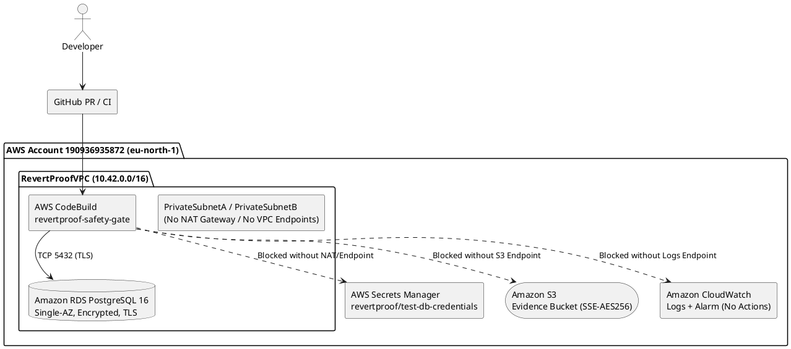

# Well-Architected Review: RevertProof

> **Classification: CONFIDENTIAL** — This report contains sensitive infrastructure details and unremediated reliability findings. Restrict distribution to authorized personnel. Do not post to broadly visible channels or ticketing systems without explicit approval.

## Coverage Audit
- Run: `war-20261127-103100-rel` | Started: `2026-11-27T10:31:00Z` | Mode: `pillar-scoped (Reliability)` (user-accepted degraded title-based run)
- Review Integrity: no embedded instructions found
- Review status: COMPLETE (degraded title-based; Reliability Pillar scope)
- BP pages read: 0 / Reliability Pillar in scope (no documentation access; `mcp_error: aws___read_documentation not available in this session` and no standalone web-fetch tool available; user agreed to proceed with disclosed degraded review per `SKILL.md` line 14)
- BP IDs cited from internal knowledge, unverified; not checked against the live framework
- Evidence sources inspected directly: `infra/cloudformation/revertproof-stack.yaml`, `buildspec.yml`, `src/revertproof/aws_integration.py`, `src/revertproof/db.py`, `src/revertproof/gate.py`, and live deployed AWS CloudFormation stack `revertproof-hackathon` (`eu-north-1`, account `190936935872`)

## Executive Summary
- **Date**: 2026-11-27
- **Workload**: RevertProof — Database-Aware Deployment Rollback Verification Platform
- **Business Criticality**: High (CI/CD deployment safety gate protecting production database rollbacks)
- **Lens Applied**: General (Pillar-Scoped: Reliability)
- **Packages Analyzed**: `infra/cloudformation/revertproof-stack.yaml`, `buildspec.yml`, `src/revertproof/aws_integration.py`, `src/revertproof/db.py`, `src/revertproof/gate.py`
- **Questions Assessed**: 13/13 (Reliability Pillar: REL01–REL13, title-based)
- **Findings**: 1 Critical, 3 High, 2 Medium, 1 Low
- **Overall Maturity**: 3/5 — Strong foundational isolation, encryption, TLS, and deterministic fail-closed gating (`exit 1`/`exit 2`), but private VPC routing gaps, unrouted CloudWatch alarms, Single-AZ RDS, and non-adaptive AWS SDK retry settings create avoidable reliability failures.

## Architecture Overview

RevertProof orchestrates migration scanning, isolated PostgreSQL V1/V2 compatibility testing, and exact minor-unit data integrity checks. In AWS (`revertproof-hackathon`, `eu-north-1`), `SafetyGateCodeBuild` runs inside private VPC subnets (`10.42.1.0/24`, `10.42.2.0/24`) against a private encrypted Amazon RDS PostgreSQL 16 instance, retrieves credentials from Secrets Manager, writes JSON/HTML evidence to S3, and emits `DeploymentBlocked` metrics to CloudWatch.

## Pillar Scorecard
| Pillar | Score (1-5) | Questions Assessed | Key Strength | Key Gap |
| -------- | ------------- | ------------------- | -------------- | --------- |
| Reliability | 3 | 13/13 | Fail-closed safety gate (`CONDITIONAL` exit 2 on DB outage), isolated schema reset/cleanup, bounded DB reconnect retries | Private subnets lack VPC endpoints / NAT route for CodeBuild AWS API egress; CloudWatch alarm has no SNS notification action; AWS SDK lacks adaptive retry/timeout configuration; Single-AZ RDS |

## Per-Question Assessment
| ID | Question | Status | Risk | Key Evidence |
| --- | --- | --- | --- | --- |
| REL01 | How do you manage service quotas and constraints? | Partially Implemented | Low | `db.t4g.micro` and `BUILD_GENERAL1_SMALL` sized for test workload (`revertproof-stack.yaml:26-29,299`); no quota alarms configured |
| REL02 | How do you plan your network topology? | Not Implemented | Critical | `PrivateRouteTable` (`revertproof-stack.yaml:70-89`) has no NAT Gateway and no VPC Endpoints for S3/Secrets Manager/CloudWatch, isolating `SafetyGateCodeBuild` from AWS APIs |
| REL03 | How do you design your workload service architecture? | Implemented | Low | Modular separation of scanner, DB adapter, integrity checker, gate, and AWS integration (`src/revertproof/`) |
| REL04 | How do you design interactions in a distributed system to prevent failures? | Partially Implemented | Medium | `db.py:55-64` implements bounded retry backoff for PostgreSQL, but `aws_integration.py:32,57,98` uses default `boto3` clients without timeouts or adaptive retries |
| REL05 | How do you design interactions in a distributed system to mitigate or withstand failures? | Partially Implemented | High | `gate.py:90-149` fails closed (`CONDITIONAL` exit 2) when DB or Secrets Manager fails, but `publish_evidence_to_s3` (`aws_integration.py:81-83`) degrades silently without retry/alerting |
| REL06 | How do you monitor workload resources? | Partially Implemented | High | `DeploymentBlockedAlarm` (`revertproof-stack.yaml:223-238`) has no `AlarmActions` (SNS topic) and only monitors `Domain=banking`; no RDS availability/storage/CPU alarms |
| REL07 | How do you design your workload to adapt to changes in demand? | Not Applicable | Low | Ephemeral CI/CD test runner; CodeBuild scales per build invocation automatically |
| REL08 | How do you implement change? | Implemented | Low | Core purpose of RevertProof: automated pre-deployment V1/V2 compatibility & Expand-and-Contract verification (`buildspec.yml`, `ci.yml`) |
| REL09 | How do you back up data? | Partially Implemented | Medium | S3 versioning enabled (`revertproof-stack.yaml:188-189`); RDS `BackupRetentionPeriod: 1` (`revertproof-stack.yaml:168`) is minimal if test baselines are preserved |
| REL10 | How do you use fault isolation to protect your workload? | Partially Implemented | High | Two AZ subnets defined (`PrivateSubnetA`, `PrivateSubnetB` at `revertproof-stack.yaml:48-68`), but `IsolatedTestRDS` (`lines 150-171`) is Single-AZ (`MultiAZ` unset) |
| REL11 | How do you design your workload to withstand component failures? | Partially Implemented | High | Single-AZ RDS (`revertproof-stack.yaml:150-171`) and single-node SQLite `StateStore` (`src/revertproof/store.py:38`) |
| REL12 | How do you test reliability? | Implemented | Low | 28 automated tests including DB-unavailable failure handling (`tests/test_gate_and_dashboard.py:50-63`) and conflict guards |
| REL13 | How do you plan for disaster recovery (DR)? | Partially Implemented | Medium | Full Infrastructure-as-Code enables stack rebuild (`revertproof-stack.yaml`), but RTO/RPO and automated rebuild runbook are not formally codified |

## Recalled BP references (unverified)
| BP ID | Recalled title | Status | Risk |
| --- | --- | --- | --- |
| REL02-BP01 (unverified) | Use highly available network connectivity for your workload public endpoints | Not Implemented | Critical |
| REL05-BP03 (unverified) | Control and limit retry calls | Partially Implemented | Medium |
| REL06-BP01 (unverified) | Monitor all components for the workload | Partially Implemented | High |
| REL06-BP03 (unverified) | Send notifications | Not Implemented | High |
| REL10-BP01 (unverified) | Deploy the workload to multiple locations | Partially Implemented | High |
| REL09-BP01 (unverified) | Identify and back up all data that needs to be backed up | Partially Implemented | Medium |

## Critical and High Risk Findings

### REL-01 (Critical) — Private VPC Subnets Lack Outbound Routing / VPC Endpoints for CodeBuild AWS API Access
- **Pillar**: Reliability (`REL02-BP01 (unverified)`)
- **Description**: `SafetyGateCodeBuild` is attached to `PrivateSubnetA` and `PrivateSubnetB` (`revertproof-stack.yaml:317-323`), but `PrivateRouteTable` (`lines 70-89`) has neither a VPC Gateway Endpoint for S3 nor VPC Interface Endpoints (Secrets Manager, CloudWatch Logs) nor a NAT Gateway route.
- **Evidence**: `infra/cloudformation/revertproof-stack.yaml:70-89, 317-323`
- **Impact Assessment**: Impact Severe, Likelihood High (Critical) — CodeBuild jobs running inside the private VPC cannot reach Secrets Manager, S3, CloudWatch, or GitHub/PyPI, causing 100% of VPC-attached CI safety gate builds to time out and block every deployment.
- **Recommendation**: Add an S3 Gateway VPC Endpoint (free) on `PrivateRouteTable`, plus either Interface VPC Endpoints (Secrets Manager, CloudWatch Logs, CloudWatch Monitoring) or a controlled egress route so CodeBuild reliably reaches AWS APIs without exposing RDS publicly.
- **Effort**: Low–Medium | **AWS Services**: Amazon VPC, AWS CodeBuild, Amazon S3, AWS Secrets Manager, Amazon CloudWatch

### REL-02 (High) — CloudWatch Alarm Has No Notification Actions and Misses Non-Banking Domains & RDS Health
- **Pillar**: Reliability (`REL06-BP01 (unverified)`, `REL06-BP03 (unverified)`)
- **Description**: `DeploymentBlockedAlarm` (`revertproof-stack.yaml:223-238`) has no `AlarmActions` configured, monitors only `Domain=banking`, and no CloudWatch alarms exist for RDS `FreeStorageSpace`, `CPUUtilization`, or `DatabaseConnections`.
- **Evidence**: `infra/cloudformation/revertproof-stack.yaml:223-239`
- **Impact Assessment**: Impact Moderate, Likelihood High (High) — Blocked unsafe migrations and degraded test RDS instances occur silently without notifying on-call engineers or release managers.
- **Recommendation**: Create an KMS-encrypted Amazon SNS topic (`RevertProofAlertsTopic`) with a least-privilege topic policy (`aws:SourceAccount`), wire `AlarmActions` to `DeploymentBlockedAlarm`, add RDS health alarms (`FreeStorageSpace`, `CPUUtilization`), and emit an aggregate `Domain=all` metric so all repositories trigger alerts.
- **Effort**: Low | **AWS Services**: Amazon CloudWatch, Amazon SNS, AWS KMS, Amazon RDS

### REL-03 (High) — Single-AZ Amazon RDS PostgreSQL Instance Without Automated Failover
- **Pillar**: Reliability (`REL10-BP01 (unverified)`)
- **Description**: `IsolatedTestRDS` (`revertproof-stack.yaml:150-171`) uses two private subnets in `DBSubnetGroup` across AZs, but does not set `MultiAZ: true`.
- **Evidence**: `infra/cloudformation/revertproof-stack.yaml:134-171`
- **Impact Assessment**: Impact Severe, Likelihood Medium (High) — An AZ disruption or RDS maintenance event makes the test database unreachable, forcing all CI/CD deployments into `CONDITIONAL` (exit 2) until the AZ recovers.
- **Recommendation**: Add a configurable `EnableMultiAZ` CloudFormation parameter (defaulting to `true` for production/team CI environments, optional `false` for low-cost student sandbox) and enable automated failover when running as a shared CI gate.
- **Effort**: Low | **AWS Services**: Amazon RDS for PostgreSQL

### REL-04 (High) — Unbounded/Non-Adaptive AWS SDK Calls Without Explicit Timeouts or Retries
- **Pillar**: Reliability (`REL05-BP03 (unverified)`)
- **Description**: `load_database_url_from_secrets_manager`, `publish_evidence_to_s3`, and `publish_cloudwatch_metrics` (`src/revertproof/aws_integration.py:32, 57, 98`) instantiate `boto3.client(...)` without `botocore.config.Config` timeouts or adaptive exponential backoff retries.
- **Evidence**: `src/revertproof/aws_integration.py:32, 57, 98`
- **Impact Assessment**: Impact Moderate, Likelihood High (High) — Transient AWS API throttling or socket stalls cause silent evidence upload loss (`s3_uploaded: False`) or stalled CI builds.
- **Recommendation**: Configure a shared `botocore.config.Config(retries={"max_attempts": 5, "mode": "adaptive"}, connect_timeout=5, read_timeout=15)` across all AWS clients and add unit tests verifying retry/timeout behavior and graceful degradation.
- **Effort**: Low | **AWS Services**: AWS Secrets Manager, Amazon S3, Amazon CloudWatch

## Medium Risk Findings
- **REL-05 (Medium — Impact Moderate, Likelihood Medium)**: Minimal RDS backup retention (`BackupRetentionPeriod: 1` at `revertproof-stack.yaml:168`). Increase to 7 days for shared team CI environments (`REL09-BP01 (unverified)`).
- **REL-06 (Medium — Impact Moderate, Likelihood Medium)**: Local SQLite `StateStore` (`src/revertproof/store.py:38`) is a single-node point of failure for multi-replica dashboard deployments (`REL11`). Migrate metadata store to PostgreSQL for HA deployments.

## Low Risk Findings
| ID | Pillar | Title | Recommendation |
| --- | --- | --- | --- |
| REL-07 | Reliability | No CloudWatch quota/throttle monitoring for CodeBuild or Secrets Manager (`REL01`) | Add Service Quotas check and CloudWatch metric alarm for CodeBuild `FailedBuilds` |

## Cross-Pillar Trade-offs
- **Reliability vs. Cost Optimization (`REL-01`, `REL-03`)**: Adding Interface VPC Endpoints or Multi-AZ RDS increases monthly AWS spend vs. a single-AZ sandbox; however, adding a **free S3 Gateway Endpoint**, **SNS-backed CloudWatch alarms**, and **adaptive `boto3` retry/timeout config (`REL-04`)** delivers major Reliability gains at near-zero cost.

## Prioritize Improvements — Eisenhower Matrix

| Quadrant | Action | Findings |
| ---------- | -------- | ---------- |
| **Do First** (High Importance, Low Effort) | Implement immediately | `REL-01` (S3 Gateway Endpoint + VPC route hardening), `REL-02` (SNS-encrypted CloudWatch Alarms + RDS health alarms), `REL-04` (Adaptive `boto3` retries & timeouts) |
| **Plan** (High Importance, High Effort) | Schedule in roadmap | `REL-03` (Multi-AZ RDS parameter), `REL-06` (PostgreSQL metadata store) |
| **Delegate** (Low Importance, Low Effort) | Batch together | `REL-05` (7-day RDS backup retention), `REL-07` (CodeBuild failed-build alarm) |
| **Defer** (Low Importance, High Effort) | Revisit next iteration | Multi-region active-active CI runner failover |

## Prioritized Remediation Plan

### Quick Wins (< 1 week) — "Do First" quadrant
| Finding | Action | SMART Goal | Owner Suggestion | Effort |
| --------- | -------- | ----------- | ----------------- | -------- |
| `REL-01` | Add S3 Gateway VPC Endpoint on `PrivateRouteTable` + configurable Interface Endpoints | Achieve 100% private-subnet S3 evidence delivery with zero public internet exposure for S3 within 1 day | Platform / DevOps | Low |
| `REL-02` | Add KMS-encrypted SNS topic + wire `AlarmActions` to `DeploymentBlockedAlarm` + add RDS `FreeStorageSpace` & `CPUUtilization` alarms | Route 100% of blocked deployments and RDS health breaches to SNS within 1 day | SRE / DBRE | Low |
| `REL-04` | Add shared `botocore.config.Config(retries={"max_attempts": 5, "mode": "adaptive"}, connect_timeout=5, read_timeout=15)` + unit tests | Eliminate hanging AWS SDK calls and verify retry config in automated tests within 1 day | Backend Engineer | Low |

### Foundation (1-4 weeks) — "Plan" quadrant
| Finding | Action | Phases | Effort | Dependencies |
| --------- | -------- | -------- | -------- | -------------- |
| `REL-03` | Parameterize `EnableMultiAZ` on `IsolatedTestRDS` | Phase 1: Add CFN parameter; Phase 2: Enable in team CI account | Medium | Budget approval |
| `REL-06` | Replace SQLite `StateStore` with PostgreSQL backend | Phase 1: Add SQLAlchemy/psycopg repo; Phase 2: Migrate dashboard | High | Shared RDS schema |

## Next Steps
1. **Remediate `REL-01`, `REL-02`, and `REL-04` immediately** (high-impact Reliability quick wins in `revertproof-stack.yaml` and `src/revertproof/aws_integration.py`).
2. Add automated tests validating adaptive AWS SDK retry/timeout configuration and CloudFormation template integrity.
3. Redeploy `revertproof-hackathon` to `eu-north-1`, re-run live S3 + CloudWatch verification, and preserve the post-remediation assessment in `docs/well-architected-after.md`.
4. Update the homepage **Architecture Review & Remediation** (`01`–`05`) cards with exact before/after evidence and push to GitHub.
